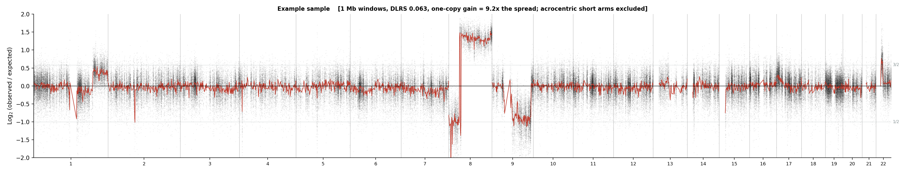
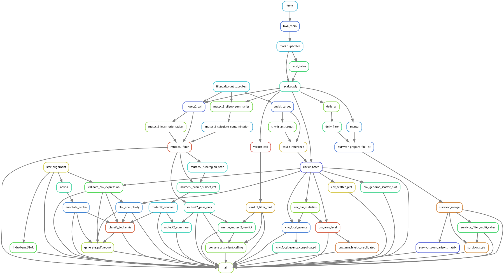

<div align="center">

# VKaryo

**A virtual karyotype from sequencing data.**

One automated run over paired RNA-seq and whole-exome sequencing that detects
gene fusions, chromosomal translocations, copy number changes and
single-nucleotide variants together, and reads them as one picture of the
genome.

[](LICENSE)
[](https://snakemake.readthedocs.io)
[](https://www.python.org/)
[](CITATION.cff)

</div>

---

> **Status.** This is release `v0.1.0`, the version accompanying the
> manuscript. The local web interface is not part of this release but is
> available upon request from the corresponding author and is planned for
> inclusion in a future version.

---

## Why this exists

Conventional karyotyping resolves changes of about 5 to 10 Mb, needs dividing
cells, and typically reads 20 metaphases. FISH sees further but only where a
probe was placed. Microarrays cover the genome but cannot see a balanced
translocation.

Sequencing lifts all three limits at once — but the tools are scattered. One
pipeline finds fusions in RNA. Another finds structural variants in DNA. A
third calls copy number. Each produces its own table, in its own vocabulary,
and the person reading them has to hold the genome in their head to see that
three of those tables are describing the same event.

**VKaryo runs them as one workflow and reconciles the output**, so a
chromosomal picture comes out the other end instead of four disconnected
files.

<div align="center">

<br>
<em><b>The virtual karyotype.</b> Coverage ratio across the genome, 1 Mb windows.
Grey points are individual windows, the red line their running median. Read it
the way cytogenetics reads a karyogram: a high-level amplification on
chromosome 8, loss of the short arm of chromosome 9 with a deep focal drop
inside it, and a gain near the end of chromosome 22 — each one a call the
workflow also writes to a table, here shown as the evidence behind it.</em>
</div>

---

## How it is put together

<div align="center">

<br>
<em>The 48 rules of the workflow. Left branch: transcriptome. Right branch: exome.</em>
</div>

---

## What it detects

| Class | From | Tools |
|---|---|---|
| **Gene fusions** | RNA-seq | STAR two-pass + Arriba, with confidence stratification |
| **Structural variants** | WES | Manta and DELLY, merged by SURVIVOR, annotated with AnnotSV |
| **Copy number** | WES | CNVkit, plus coverage-based focal and arm-level calling |
| **SNVs and indels** | WES | Mutect2 tumour-only, with VarDict for low-VAF variants |
| **Classification** | all of the above | driver panel, WHO-HAEM5/ICC entity, risk stratification |

---

## Three things it does differently

### Deep deletions are measured, not inferred from log2

With a flat reference, the log2 ratio stops meaning anything once a segment's
coverage approaches zero — the number reported is the method's numeric floor,
not the size of the loss. A segment whose real value is around −5 can be
reported as −23.

That matters because **homozygous deletion is often the finding with the most
clinical weight**, and it is exactly the regime where the usual metric fails.
VKaryo judges deep losses by observed versus expected coverage per measurement
window, so the call rests on something that is still a measurement at zero.

### V(D)J loci are flagged, not silently dropped

Every lymphoid sample shows the immunoglobulin and T-cell receptor loci
partly empty — V(D)J recombination physically excises those segments. That is
normal lymphocyte biology, not a deletion.

Other pipelines either report it as a finding or filter it away. VKaryo marks
it and **keeps it in the output**, so the call can be audited rather than
silently disappearing.

### A filter flag is a priority for review, not a delete key

When a workflow passes only fully-filtered calls to annotation, a heuristic
flag stops being a hint and becomes a silent discard: the variant is gone
before anyone can look at it. Real pathogenic mutations are lost this way,
particularly in genes where clustered mutations are the biology.

VKaryo keeps flagged calls in the annotated output with the flag recorded.
**Deciding what to discard is the analyst's job, and it happens last.**

---

## Quick start

```bash
git clone https://github.com/brunorsci/VKaryo.git
cd VKaryo
conda env create -f envs/vkaryo.yaml && conda activate vkaryo

# reference files: see docs/references.md
cp config/config.yaml config/my_config.yaml   # then edit the paths

# check every path resolves, without running anything
snakemake --configfile config/my_config.yaml --rulegraph > /dev/null && echo OK

snakemake --configfile config/my_config.yaml --cores 16 --use-conda
```

**Try it without any reference data.** The repository ships a self-contained
example: synthetic reads carrying a planted fusion and a planted homozygous
deletion, against a minimal reference. It runs in minutes, and because the
answer is known by construction it doubles as a regression check — see
[`docs/example.md`](docs/example.md).

---

## Requirements

Linux, Conda or Mamba, Snakemake ≥ 7.0, Python ≥ 3.9, 64 GB RAM, and about
500 GB of disk for reference files. Per-rule software is declared in `envs/`
and installed by Snakemake itself with `--use-conda` — no manual tool
installation.

Measured on a 100-sample cohort, on one Intel Xeon Gold 6258R (28 cores,
2.70 GHz) with 125 GB RAM: a median of **7.4 hours of wall time and 6.3 hours
of CPU per sample**, processing exome and transcriptome together, with a peak
of 29 GB of memory.

---

## Output

| Path | Content |
|---|---|
| `arriba/` | fusion calls with confidence |
| `mutect2/`, `vardict/` | annotated somatic SNVs and indels |
| `survivor/`, `annotsv/` | consensus structural variants, annotated |
| `cnvkit/` | copy number segments |
| `cnv_focal/`, `cnv_arm/` | coverage-based focal events and arm imbalance |
| `classification/` | entity assignment and risk stratification |

The detection steps do not depend on the disease under analysis and apply to
cancer and non-cancer samples alike; the classification modules are specific
to haematological neoplasms.

Final tables require review by a qualified bioinformatician. VKaryo is built
to put the evidence in front of that person, not to replace them.

---

## Documentation

| | |
|---|---|
| [`docs/references.md`](docs/references.md) | every reference file, where to get it, how to build the indexes |
| [`docs/example.md`](docs/example.md) | the worked example, step by step |
| [`config/config.yaml`](config/config.yaml) | configuration template, every entry documented |

---

## Citing

Validation against a public reference panel of haematological cell lines is
reported in the accompanying article. Software citation metadata is in
[`CITATION.cff`](CITATION.cff).

## Licence

MIT — see [`LICENSE`](LICENSE).
